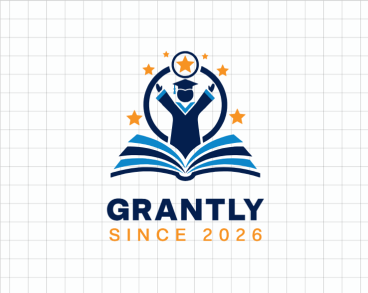

# GRANTLY — Your Future, Funded.

<div align="center">
  
  <p><strong>A unified scholarship discovery, eligibility assessment, and application tracker platform.</strong></p>
  <p><em>Frontend Development Hackathon — THE OUTPOST (November 2026)</em></p>

  [](https://react.dev/)
  [](https://vitejs.dev/)
  [](https://www.typescriptlang.org/)
  [](https://tailwindcss.com/)
  [](https://greensock.com/gsap/)
  [](https://www.framer.com/motion/)
</div>

---

## 🌟 Overview

**GRANTLY** simplifies the higher education funding journey for students across India. It bridges the gap between students and verified scholarship opportunities through an intelligent, transparent rule-based eligibility assessment engine, interactive application lifecycle management, and a cinematic scroll-driven landing experience.

---

## ✨ Key Features

### 1. 🎬 Cinematic Scroll-Driven Landing Page
- **Cinematic Opening Reveal**: Inspired by European chamber music aesthetic, featuring an ambient curtain reveal with `GRANTLY • SINCE 2026`.
- **Interactive Circular Logo Portal**: Centered circular emblem with glowing ambient aura. Clicking or scrolling scales through the logo portal directly into the platform.
- **Scroll-Expanding Showcase (dozfx style)**: Pinned scroll section where the photograph of Indian students studying with the portal dynamically expands from `80vw` to `98vw` with parallax zoom.
- **Interactive Feature Cards**: *Smart Explorer*, *Explainable Matching*, and *Unified Tracker* appearing with staggered entrance animations.
- **Dark Statistics Banner**: Showcase of listed grant pool metrics (`₹15.8L+`), application stages, and instant matching performance.

### 2. 🔐 Authentication & Backend Integration
- **Continue with Google**: Integrated with Google Identity Services (GSI) OAuth 2.0 with Client ID configuration in `.env`.
- **Single-Click Auth**: Clean modal with email registration, password sign-in, and instant Google authentication.
- **Backend API & Local Persistence**: Stores registered scholar accounts, login sessions, and timestamps with full log-out functionality.

### 3. 🎯 Rule-Based Eligibility Engine (Implementation Plan §5.2)
Transparent 100-point compatibility scoring:
- **Academic Score (30%)**: Matches student percentage vs. minimum cutoff.
- **Annual Family Income (30%)**: Verifies ceiling limits.
- **Course Compatibility (20%)**: Matches field of study/majors.
- **Domicile State & Category (20%)**: Checks regional reservations & affirmative categories.
- Includes explainable criteria breakdown and disqualification warnings.

### 4. 📊 Student Academic Dashboard & Tracker
- **Key Metrics Panel**: Active eligible grants, potential aid pool calculation, in-progress reviews, and saved bookmarks.
- **Scholarship Explorer**: Real-time filtering by category, search by program/provider, and *“Show 100% Eligible Only”* toggle.
- **Application Lifecycle Tracker**: 5-stage status workflow: `Saved` → `Applied` → `Under Review` → `Approved` / `Rejected`.
- **Dynamic Student Profile**:
  - Automatically calculates age from date of birth.
  - University / College name tracking.
  - Live state search with autocomplete spelling recommendations across all 28 Indian States & 8 UTs.

### 5. 🌓 Dual-Theme System (BSG Compliant)
- Working Light Theme (`#F5F7FB`, `#FFFFFF`) and Dark Theme (`#0B1423`, `#19263A`) toggles accessible across both the landing page and the dashboard top bar.
- Electric Blue (`#3985FF`) and Midnight Navy (`#101B2D`) brand tokens.

---

## 🛠️ Technology Stack

| Technology | Role |
| :--- | :--- |
| **React 19 + TypeScript** | Component UI framework & static typing |
| **Vite 6** | Ultra-fast build tool and dev server |
| **Tailwind CSS v4** | Utility-first styling with custom theme variants |
| **GSAP & ScrollTrigger** | Pinned viewport scroll choreography & image expansion |
| **Framer Motion** | UI transitions, modal animations, and intro curtains |
| **Lucide React** | Outline iconography |
| **Google Identity Services (GSI)** | Google OAuth 2.0 Authentication |
| **Node.js Local API & LocalStorage** | Backend account storage & client-side persistence |

---

## 🚀 Getting Started

### Prerequisites
- Node.js (v18 or higher recommended)
- npm or pnpm

### 1. Clone the repository
```bash
git clone https://github.com/your-username/grantly.git
cd grantly
```

### 2. Install dependencies
```bash
npm install
```

### 3. Setup environment variables
Create a `.env` file in the root directory (or use the included template):
```env
# Google OAuth Configuration
VITE_GOOGLE_CLIENT_ID=your_google_client_id.apps.googleusercontent.com
GOOGLE_CLIENT_SECRET=your_google_client_secret

# Application Environment
VITE_APP_ENV=development
VITE_BACKEND_API_URL=http://localhost:5000
```

### 4. Run the development server
```bash
npm run dev
```

Open [http://localhost:5173](http://localhost:5173) in your browser.

### 5. Build for production
```bash
npm run build
```

---

## 📁 Project Structure

```
grantly/
├── public/
│   └── assets/                  # Brand logos, icons, and hero photographs
├── server/
│   ├── index.js                 # Node.js backend authentication service
│   └── database.json            # Local JSON database for registered accounts
├── src/
│   ├── assets/                  # Bundled assets (grantly-logo.png, students-hero.jpg)
│   ├── components/
│   │   ├── auth/                # AuthModal with Google OAuth & Email Sign-In
│   │   ├── common/              # Theme toggle, badges, inputs
│   │   ├── landing/             # Cinematic Landing components (GSAP ScrollTrigger)
│   │   │   ├── HeroSection.tsx          # Circular Logo Portal & Title
│   │   │   ├── IntroOverlay.tsx         # Opening curtain reveal (Since 2026)
│   │   │   ├── Navbar.tsx               # Fixed glassmorphic navigation
│   │   │   ├── ScholarshipShowcase.tsx  # Scroll-expanding image showcase
│   │   │   ├── FeatureCards.tsx         # 3-card intelligent ecosystem grid
│   │   │   ├── StatsBanner.tsx          # Midnight Navy statistics container
│   │   │   ├── Footer.tsx               # Footer with links & copyright
│   │   │   └── useScrollAnimations.ts   # GSAP ScrollTrigger timeline hook
│   │   ├── layout/              # AppShell sidebar, top bar & navigation
│   │   └── scholarships/        # ScholarshipCard, DetailsModal
│   ├── context/
│   │   ├── AppContext.tsx       # Global state (Theme, User, Applications, Bookmarks)
│   │   ├── backendAuth.ts       # Backend service connector & user storage
│   │   └── eligibility.ts       # 4-stage transparent eligibility scoring engine
│   ├── data/
│   │   └── scholarships.ts      # Sample demonstration scholarship records
│   ├── pages/                   # Landing, Dashboard, Explorer, Recommendations, Saved, Profile
│   ├── types/                   # TypeScript interfaces (Scholarship, StudentProfile, etc.)
│   ├── App.tsx                  # Main application orchestrator
│   ├── index.css                # Tailwind CSS v4 design tokens & theme setup
│   └── main.tsx                 # React DOM mount point
├── .env                         # OAuth credentials & environment configs
└── package.json
```

---

## 🎨 Brand Guidelines (BSG Alignment)

- **Electric Blue (`#3985FF`)**: Primary accent used for primary CTAs, active states, and highlights.
- **Midnight Navy (`#101B2D`)**: Brand foundation, statistics containers, and typography.
- **Cloud White (`#F5F7FB`) / Dark Background (`#0B1423`)**: Dual theme backgrounds.
- **Typography**: Inter (Body & Controls) and Manrope (Headings & Large Statistics).

---

## 📄 License

This project was built for **THE OUTPOST Frontend Development Hackathon 2026**.
All demonstration scholarship records and statistics are clearly labelled demo data for evaluation purposes.
